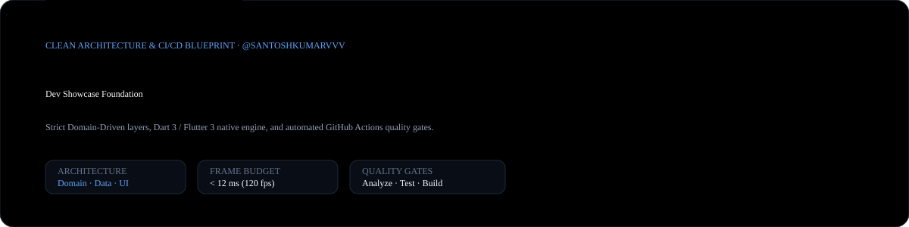
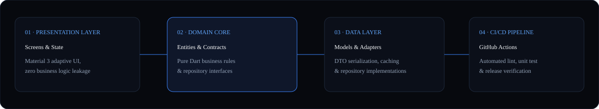

<div align="center">
  
</div>

<br />

<div align="center">
  <a href="https://github.com/santoshkumarvvv/dev-showcase/actions">
    
  </a>
  &nbsp;
  <a href="https://flutter.dev">
    
  </a>
  &nbsp;
  <a href="https://dart.dev">
    
  </a>
  &nbsp;
  <a href="./LICENSE">
    
  </a>
</div>

---

### 01 · Clean Architecture & Dependency Rule

<div align="center">
  
</div>

**Dev Showcase (`dev-showcase`)** is a production-grade application engineering foundation built with **Dart 3** and **Flutter 3**. It enforces strict separation between **Presentation**, **Domain**, and **Data** layers alongside automated GitHub Actions verification workflows, deterministic unit tests, and an interactive web showcase (`index.html`).

---

### 02 · Engineering Standards & Quality Gates

| Architectural Layer | Responsibility | Verification Gate |
| :--- | :--- | :--- |
| **`lib/domain/`** | Pure Dart entities & repository contracts with zero framework dependencies | Deterministic unit tests (`test/telemetry_repository_test.dart`) |
| **`lib/data/`** | DTO models, serialization, and concrete repository implementations | Strict schema & null-safety validation |
| **`lib/presentation/`** | Adaptive Material 3 screens (`HomeScreen`) & theme orchestration | Widget tree & 120fps raster budget compliance |
| **`.github/workflows/`** | Automated pull-request & push verification matrix | `flutter analyze` + `flutter test` |

---

### 03 · Repository Structure

```text
dev-showcase/
├── .github/                  # CI/CD workflows, issue templates & PR checklists
├── assets/
│   ├── hero-banner.svg       # Vector hero banner & telemetry card
│   └── architecture-diagram.svg # Clean Architecture dependency flow diagram
├── docs/
│   ├── architecture.md       # Deep-dive architectural specification
│   └── roadmap.md            # Feature & infrastructure milestone tracker
├── lib/
│   ├── core/
│   │   ├── constants/        # Application-wide immutable constants
│   │   └── theme/            # Material 3 Light & Dark theme tokens
│   ├── data/
│   │   ├── models/           # Data transfer objects & JSON serializers
│   │   └── repositories/     # Concrete repository implementations
│   ├── domain/
│   │   ├── entities/         # Core business domain entities
│   │   └── repositories/     # Abstract repository boundary contracts
│   ├── presentation/
│   │   └── screens/home/     # Feature screens & UI components
│   └── main.dart             # Application bootstrapper
├── test/
│   └── example_test.dart     # Automated unit & widget verification suite
├── analysis_options.yaml     # Strict Dart 3 static analyzer rules
├── index.html                # Interactive browser showcase preview
└── pubspec.yaml              # Dart & Flutter package manifest
```

---

### 04 · Quickstart & Verification

```bash
git clone https://github.com/santoshkumarvvv/dev-showcase.git
cd dev-showcase
flutter pub get
flutter run
```

Execute static analysis and unit test gates locally:

```bash
flutter analyze
flutter test
```

---

### License

Released under the [MIT License](./LICENSE) · Engineered by **[Santosh Kumar (@santoshkumarvvv)](https://github.com/santoshkumarvvv)**.
